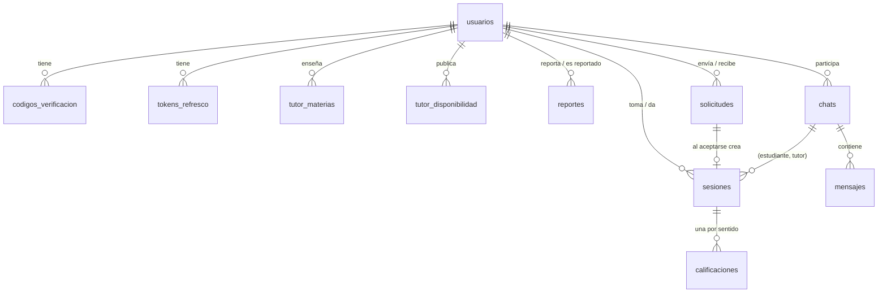

# Base de datos de Nexo

PostgreSQL 18. El esquema lo crean solo las migraciones de Flyway (`src/main/resources/db/migration`, V1 a V11); Hibernate
únicamente lo valida al arrancar (`ddl-auto: validate`). Una migración ya publicada no se edita: los cambios se agregan en
una nueva.

**Criterio de diseño.** Lo que pueda romperse con dos peticiones simultáneas lo garantiza la base, no el código. El
servicio valida primero para dar un mensaje claro; la restricción es la que asegura la regla aunque dos peticiones hayan
leído lo mismo al mismo tiempo. Las excepciones están indicadas en la sección de reglas.

## Modelo



| Tabla | Para qué | Notas |
| --- | --- | --- |
| `usuarios` | Cuenta, perfil de tutor y reputación | `rol` guarda el modo actual (`ESTUDIANTE`, `TUTOR`) o `ADMIN`. `suma_estrellas` y `total_resenas` las mantiene un trigger; `calificacion_promedio` es una columna generada |
| `codigos_verificacion` | Códigos de correo y de contraseña | Solo el hash |
| `tokens_refresco` | Sesiones de la app | Solo el hash |
| `tutor_materias` | Materias que enseña el tutor | Sin repetidos aunque cambien las mayúsculas |
| `tutor_disponibilidad` | Semana publicada (día, hora, modalidad) | Las 7 horas del calendario |
| `reportes` | Reportes a un tutor (RF11) | Uno abierto por persona y tutor |
| `solicitudes` | Pedido de tutoría (RF5, RF6) | Plazo: 24 h, o el inicio si llega antes |
| `sesiones` | Tutoría aceptada (RF10) | Una por solicitud; dura 1 h al crearla desde la API |
| `chats` | Conversación por par estudiante–tutor (RF8) | `activo_hasta`: cierre automático al terminar la última sesión |
| `mensajes` | Mensajes de un chat | `secuencia` sin huecos: es el cursor de la API. No se editan ni se borran |
| `calificaciones` | Calificación mutua y reseñas (RF4, RF9) | Una reseña es la calificación `ESTUDIANTE_A_TUTOR` |

## Reglas: quién las garantiza y qué recibe la app

| Regla | Restricción | Respuesta de la API |
| --- | --- | --- |
| Correo único | `uq_usuarios_correo` | 409 `CORREO_DUPLICADO` |
| Una cuenta de Google por usuario | `uq_usuarios_google_sub` | 409 `GOOGLE_CUENTA_DISTINTA` |
| Un reporte abierto por persona y tutor | `uq_reportes_abierto` (parcial) | 409 `REPORTE_DUPLICADO` |
| Sin repetir una solicitud viva con el mismo tutor y hora | `uq_solicitudes_activa` (parcial) | 409 `SOLICITUD_DUPLICADA` |
| Una persona no está en dos sesiones a la vez, sea tutor o estudiante en cada una | `tg_sesiones_agenda`, con las exclusiones `ex_sesiones_*_sin_solape` como segunda barrera | 409 `HORA_NO_DISPONIBLE` |
| Una calificación por sesión y sentido | `uq_calificaciones_sesion_sentido` | 409 `SESION_YA_CALIFICADA` |
| Solo se califica una sesión completada | `fk_calificaciones_sesion_completada` (compuesta, incluye el estado) | El servicio responde `SESION_NO_COMPLETADA` antes de escribir |
| No se escribe en un chat en solo lectura | `tg_mensajes_chat_activo` | 409 `CHAT_SOLO_LECTURA` |
| Una sesión tiene las personas y la hora de su solicitud | `fk_sesiones_solicitud` (compuesta) | Ninguna ruta lo intenta; sería 409 `CONFLICTO` |
| Toda sesión tiene chat | `fk_sesiones_chat` | Ninguna ruta lo intenta; sería 409 `CONFLICTO` |
| Solo transiciones válidas de solicitud y sesión | `tg_solicitudes_transicion`, `tg_sesiones_transicion` | El servicio valida antes (`SOLICITUD_NO_PENDIENTE`, etc.); si no, 409 `CONFLICTO` |
| Solicitud y sesión coherentes al confirmar | `ctg_*_coherentes` (diferidos) | Ninguna ruta lo intenta. Al fallar en el COMMIT se revierte todo; la respuesta sería un 500, sin probar por HTTP, porque indicaría un error de programación |
| Lo pedido en una solicitud no cambia | `tg_solicitudes_transicion` | Ninguna ruta lo intenta |
| De una sesión solo cambia el estado, y no se borra | `tg_sesiones_transicion`, `tg_sesiones_sin_borrado` | Ninguna ruta lo intenta |
| Una sesión que aún no acaba no nace terminada | `tg_sesiones_terminada_en_el_pasado` | Ninguna ruta lo intenta |
| Un mensaje no se edita ni se borra | `tg_mensajes_inmutables` | Ninguna ruta lo intenta |
| Una calificación no se edita (solo se puede retirar el comentario) | `tg_calificaciones_inmutables` | Ninguna ruta lo intenta |
| El promedio coincide con las calificaciones | `tg_calificaciones_reputacion` y `ck_usuarios_reputacion` | Automático |
| Hora dentro del calendario (08:00 a 20:00, cada 2 h) | `ck_solicitudes_inicio_en_calendario` | El servicio responde 422 `HORA_NO_DISPONIBLE` |

Lo que solo valida el servicio, porque depende de otras filas o del día exacto, y por lo tanto no resiste a quien escriba
directo en la base: fecha entre mañana y 14 días
(`FECHA_NO_VALIDA`; la base solo pone el tope de 15 días), hora publicada (`HORA_NO_DISPONIBLE`), modalidad ofrecida a esa
hora (`MODALIDAD_NO_DISPONIBLE`) y materia enseñada (`MATERIA_NO_OFRECIDA`). Si el tutor cambia su semana después de una
solicitud, esta sigue siendo válida: se decide al aceptarla.

## Concurrencia

| Situación | Qué pasa | Prueba en `CarrerasTutoriasTest` |
| --- | --- | --- |
| Dos solicitudes a la misma hora aceptadas a la vez | Una gana, la otra recibe `HORA_NO_DISPONIBLE` | `dosAceptacionesALaMismaHoraDejanUnaSolaSesion` |
| Varias solicitudes a la misma hora y persona aceptadas a la vez, incluso cruzando papeles | Bloqueo consultivo por persona: pasan de una en una | `unaPersonaNoQuedaEnDosSesionesCruzandoPapeles`, `unEstudianteNoQuedaEnDosSesionesALaMismaHora` |
| Aceptar y rechazar la misma solicitud | `FOR UPDATE` en la fila: un solo ganador | `aceptarYRechazarLaMismaSolicitudTieneUnSoloGanador` |
| Doble toque en Enviar | Una sola solicitud | `elMismoEnvioDosVecesCreaUnaSolaSolicitud` |
| Mensajes simultáneos y reintentos | Bloqueo del chat, secuencia sin huecos, `idCliente` no duplica | `losMensajesSimultaneosNoDejanHuecosYElReintentoNoDuplica` |
| Calificaciones simultáneas | El `UPDATE` del tutor las ordena; no se pierden estrellas | `calificacionesSimultaneasNoPierdenEstrellasNiSeRepiten` |
| Varias peticiones poniendo al día las mismas filas | Se esperan en orden de id | `lasPeticionesQuePonenAlDiaALaVezNoChocan` (comprueba que no chocan; no distingue si se quita el orden) |
| Dos reportes iguales, dos registros con un correo | Índices únicos | `dosReportesIgualesDejanUnoSolo`, `dosRegistrosConElMismoCorreoDejanUnaCuenta` |
| Un token de refresco presentado dos veces | Fila bloqueada: el segundo lo ve usado y cierra las sesiones de la cuenta | `unTokenDeRefrescoSoloSirveUnaVezAunqueLlegueDosVeces` |
| Fallos simultáneos de contraseña o de código | Fila bloqueada: suman todos y no se salta el límite | `losFallosDeLoginSimultaneosCuentanTodos`, `losIntentosSimultaneosDeUnCodigoCuentanTodos` |
| El código correcto enviado varias veces a la vez | Fila bloqueada: el segundo lo ve cerrado | `elMismoCodigoCorrectoEnviadoDosVecesSirveUnaSolaVez` |
| Una transacción colgada | `lock_timeout` de 5 s: 409 `CONFLICTO` en vez de esperar sin fin | `unaEsperaDeBloqueoQueVenceSeVuelveConflicto`, `unaEsperaDeBloqueoEnElLoginSeVuelveConflicto` |

Una aceptada se puede cancelar después: aceptar y luego cancelar son dos operaciones válidas, y ambas responden 200.

La app ya serializa el refresco del token (`AutenticadorSesion` es `@Synchronized`), así que la detección de reutilización
no la saca de la cuenta cuando varias peticiones reciben 401 a la vez.

Un interbloqueo sigue siendo posible en dos casos teóricos:

- `poner()` toma el chat y luego la solicitud, y `aceptar()` al revés. Exige que en el mismo instante venza una solicitud y termine una sesión del mismo par.
- Una aceptación tiene el bloqueo consultivo de una persona y espera un chat que tiene otra transacción, cuyo `poner()` lo tomó al cerrar una sesión y que después pide ese mismo bloqueo. La sesión tiene que terminar justo entre el inicio de las dos.

Los dos acaban en 409 `CONFLICTO`, que la app puede reintentar, y no dejan nada a medias. En una prueba del revisor, las
aceptaciones compitiendo por la misma hora pasaron de 23 interbloqueos a 0 en 32 000 inserciones.

## Lo que depende del tiempo, sin procesos programados

No hay tareas en segundo plano. `TutoriasAlDia.poner()` corre al inicio de las operaciones de solicitudes, sesiones y
resumen y, en la misma
transacción, pasa a `COMPLETADA` las sesiones terminadas (y a `FINALIZADA` su solicitud) y a `EXPIRADA` las solicitudes
vencidas. Casi siempre no hay nada que cambiar y lo resuelven índices parciales.

Se esperaba usar `SKIP LOCKED`, pero las pruebas de concurrencia mostraron que produce un `SESION_NO_COMPLETADA` falso:
una petición se saltaba la sesión que otra estaba cerrando y la veía todavía programada. Por eso espera el bloqueo, en
orden de id.

**Consecuencia:** una sesión terminada sigue como `PROGRAMADA` en la base hasta la siguiente de esas operaciones. Las
rutas de sesiones, solicitudes y resumen la ven al día. Las demás no pasan por `poner()`, y no les afecta o se aceptó:

- **Chats:** dependen de `activo_hasta`, que deja el chat en solo lectura al llegar la hora.
- **Disponibilidad:** solo mira horas futuras.
- **Perfil público del tutor:** su cifra de sesiones cuenta también las `PROGRAMADA` ya terminadas (`Resenas`), así que sale bien aunque nadie haya puesto al día.

## Llegar a una sesión presencial: PIN, retardo y penalización (V12)

Una presencial no empieza por la hora: empieza cuando los dos prueban que se encontraron.

1. El tutor llega y envía el PIN (`POST /api/sesiones/{id}/pin`), desde 30 minutos antes de la hora. Hasta entonces el estudiante no lo ve.
2. El estudiante se lo dice y el tutor lo escribe (`POST /api/sesiones/{id}/iniciar`). Al tutor la API nunca le entrega el PIN. Con 5 errores se bloquea 5 minutos.
3. `fn_sesion_limite` calcula hasta cuándo se puede: 10 minutos después de la hora vigente o, si el PIN llegó más tarde, de que llegó; nunca más allá del final. Está en una sola función porque la usan la puesta al día y la vista.

Vencido el límite, `TutoriasAlDia` cancela la sesión y su solicitud en la misma sentencia, y deja la penalización:

| Qué faltó | `cierre` | Se penaliza a | `nivel` |
| --- | --- | --- | --- |
| El tutor no envió el PIN | `TUTOR_NO_LLEGO` | Tutor | `NORMAL`, o `GRAVE` si ya había retardo pactado |
| El PIN se envió, nadie lo escribió | `ESTUDIANTE_NO_LLEGO` | Estudiante | `NORMAL`, o `GRAVE` si ya había retardo pactado |

**Retardo pactado.** `acuerdos_sesion` guarda lo que uno propone y el otro acepta o rechaza; cada paso queda escrito además como mensaje del chat. Quien propone un retardo es quien va tarde. Se acepta uno por sesión (`uq_acuerdos_un_retardo`), hasta 60 minutos después de la hora original, y la sesión sigue terminando a la misma hora porque otra puede venir después. Proponer no detiene el reloj. Aceptar una cancelación cierra con `cierre = ACORDADA`, sin penalización.

**Efecto de la penalización (V13 y V14).** Una `NORMAL` solo suma al contador, que muestra los últimos 90 días (`fn_penalizaciones_recientes`). Una `GRAVE` además pausa la cuenta (`fn_pausa_hasta`): 7 días, 14 si es la segunda en 90 días y 30 desde la tercera. La tercera `NORMAL` en 90 días pausa 7 días (V14). Durante la pausa no puede enviar ni aceptar solicitudes y sale del catálogo, pero lo ya agendado sigue. La pausa no tiene columna: se deduce de `creado_en`, así que termina sola.

**Revisión (V13).** Quien cree que fue un error pide una revisión, una por penalización y hasta 7 días después (`revisiones_penalizacion`). La pausa sigue mientras tanto. Si la revisión queda `ACEPTADA`, la penalización sale de `penalizaciones_firmes` y deja de contar, sin tocar la fila inmutable. La resuelve un administrador en el panel web de `/admin` (RF12).

**Límites conocidos:**
- Las virtuales no usan PIN ni se vencen: nada prueba que alguien se conectó.
- El PIN prueba un encuentro solo si las personas no lo comparten por otro medio. Un tutor podría enviarlo sin haber llegado, o no escribir uno correcto para perjudicar al estudiante: para esos casos sigue el reporte.
- Como todo lo que depende del tiempo aquí, la cancelación ocurre en la siguiente petición de cualquier cuenta, no en el segundo exacto.

## Índices

| Índice | Consulta que sirve |
| --- | --- |
| `ix_usuarios_catalogo` (parcial) | `GET /api/tutores`: mismo orden que el catálogo, paginación estable |
| `ix_solicitudes_estudiante`, `ix_solicitudes_tutor` | Listas de solicitudes por modo. Filtran por persona; el orden final (`ORDER BY CASE`) se resuelve con un Sort sobre pocas filas |
| `ix_solicitudes_por_vencer`, `ix_sesiones_por_terminar` (parciales) | Puesta al día en cada petición |
| `ix_sesiones_tutor`, `ix_sesiones_estudiante` | Sesiones e historial, la más reciente primero |
| `ix_sesiones_*_programadas` (parciales) | Próximas sesiones del Inicio. Con pocos datos el planificador prefiere el GiST de las exclusiones; conviene medirlos con carga antes de decidir si sobran |
| `ix_chats_tutor` | Bandeja del tutor (la del estudiante usa `uq_chats_par`) |
| `uq_mensajes_chat_secuencia` | Mensajes por cursor |
| `ix_calificaciones_resenas_tutor` (parcial) | `GET /api/tutores/{id}/resenas` |
| `ix_reportes_tutor`, `ix_reportes_reportante`, `ix_tokens_refresco_usuario`, `ix_codigos_usuario_proposito` | Claves foráneas y búsquedas por usuario |

### Mediciones

Sobre un esquema de carga con 50 000 usuarios, 283 000 sesiones, 411 000 solicitudes, 400 000 calificaciones y 1,3 millones
de mensajes, en este PC y con la caché caliente (segunda ejecución de `EXPLAIN ANALYZE`):

| Consulta | Tiempo |
| --- | --- |
| Primera página del catálogo | 0,05 ms (con el promedio calculado en cada búsqueda: 262 ms) |
| Conteo total del catálogo, que la API también ejecuta (20 000 tutores) | 8–43 ms |
| 30 mensajes por cursor | 0,07 ms |
| Próximas sesiones de un estudiante | 0,04 ms |
| Historial de un estudiante | 0,06 ms |
| Buscar sesiones terminadas / solicitudes vencidas | 0,4 ms / 0,6 ms |
| Límite de mensajes por minuto, en un chat con 50 048 mensajes | 0,1 ms |
| Comprobación de agenda al aceptar | 0,5 ms |
| Bandeja de chats normal | ~1,4 ms |
| Bandeja de un tutor con muchísimos chats | ~125–140 ms |

Límites de estas cifras: ese esquema es de la validación previa del diseño, no una copia exacta de V9 (por ejemplo, no tenía
los índices con el nombre final de la puesta al día y usó otros equivalentes). Las dos últimas filas y los 262 ms vienen de
esa validación. Miden consultas sueltas, no carga con muchos usuarios simultáneos.

## Decisiones de tipos

- **Momentos:** `TIMESTAMPTZ`. Fecha y hora de la API se derivan en hora de Colombia (`America/Bogota`). `tutor_disponibilidad.hora` es `TIME` porque es una franja semanal, no un momento.
- **Hora de referencia:** nunca el teléfono. La puesta al día y las transiciones usan `now()` de la base. Las validaciones previas del servicio (plazos, si una sesión ya empezó) usan el reloj del servidor. Si los dos relojes se desfasan, el servicio deja pasar y el trigger rechaza con 409 `CONFLICTO`: el error es visible y el dato queda correcto.
- **Orden de textos:** la base usa `C.UTF-8`, que ordena por código: `Álvaro` queda después de `Zoe`. Solo afecta los empates del catálogo. La CI crea su base con la misma collation. Para un orden alfabético en español habría que fijar una collation ICU en `usuarios.nombre`.
- **Dinero:** `NUMERIC(10,2)` en `precio_hora`, nunca coma flotante.
- **Ids:** UUID generados por la aplicación. No revelan cuántos registros hay ni permiten adivinar otros.
- **Enumeraciones:** `VARCHAR` con `CHECK`. Agregar un valor es una migración corriente, a diferencia de `CREATE TYPE ... ENUM`.
- **Secretos:** contraseñas, códigos y tokens de refresco guardan solo el hash.
- **`ON DELETE`:** `CASCADE` en lo que no tiene sentido sin la cuenta (tokens, códigos, materias, disponibilidad). `RESTRICT` en lo que es historial o evidencia de otra persona (solicitudes, sesiones, chats, mensajes, calificaciones, reportes).
- **Bloqueos:** `lock_timeout` de 5 s en cada conexión, para que una transacción colgada no frene las demás.

## Datos personales y borrado de cuentas (Ley 1581 de 2012)

`POST /api/usuarios/yo/eliminar` (`EliminacionCuenta`) anonimiza en lugar de borrar: por el `RESTRICT`, un `DELETE` se llevaría sesiones y reseñas de otras personas. Se van nombre, `handle`, correo, documento, universidad, carrera, bio, tarifa, hash de contraseña, tokens, códigos, materias y horario; `estado_cuenta` queda en `ELIMINADA`; y sus solicitudes pendientes se cierran. Con tutorías agendadas responde `CUENTA_CON_SESIONES`.

Se conserva el texto libre, que puede contener datos personales: `mensajes.texto`, `calificaciones.comentario`, `solicitudes.tema`, `solicitudes.mensaje`, `solicitudes.motivo_rechazo` y `reportes.motivo`. Los mensajes son inmutables y también son de la otra persona. Esto debe revisarlo el equipo con la política de tratamiento de datos; no es una opinión legal.

Los registros del servidor no incluyen el `Detail` de los errores de PostgreSQL, que traería la fila completa con el correo
y el hash (`logServerErrorDetail=false` y `ManejadorErrores.sinDetalle`).

Otros pendientes conocidos:

- `documento_identidad` se guarda sin cifrar. Es opcional; si llega a usarse en producción conviene cifrarlo o eliminarlo.
- `LimpiezaProgramada` borra cada madrugada los tokens vencidos y los códigos de más de un día.
- `nexo.correo.modo` es `smtp` en el perfil `prod` (`EnviadorCorreoSmtp`) y `consola` en los demás.
- Copias de seguridad: las del proveedor; ver `despliegue.md`. Una restauración completa con `pg_dump` funciona en teoría, pero no se ha probado. `pg_restore --data-only` fallaría por `tg_mensajes_numera` y `tg_sesiones_agenda`.

## Pruebas: PostgreSQL en lugar de H2

Las pruebas corrían en H2, que no tiene exclusiones `GIST`, índices parciales con esta sintaxis, triggers `plpgsql` ni el
mismo manejo de bloqueos: las reglas más importantes no se podían probar allí. Ahora usan PostgreSQL real.

**Para correrlas** hace falta PostgreSQL local con la base y el usuario `nexo` (clave `nexo`), o las variables
`NEXO_PRUEBAS_DB_URL`, `NEXO_PRUEBAS_DB_USUARIO` y `NEXO_PRUEBAS_DB_CLAVE`:

```bash
sudo -u postgres psql -c "CREATE ROLE nexo LOGIN PASSWORD 'nexo'" -c "CREATE DATABASE nexo OWNER nexo"
cd backend && ./gradlew test
```

Las pruebas trabajan en el esquema `pruebas`, nunca en `public`: una guarda en
`PruebasConBaseLimpia` se niega a limpiar cualquier esquema cuyo nombre no empiece por `pruebas`. La CI levanta PostgreSQL 18
como servicio.

## Qué se probó y qué no

Comprobado en este PC con PostgreSQL 18.6:

- 348 pruebas del backend en verde; las de concurrencia se repitieron 5 veces más sin fallos.
- Las migraciones V8 a V11 se aplicaron sobre una base existente en V7 con datos de prueba, y sobre esquemas vacíos.
- Recorrido en la app (emulador) con la base hasta V9: iniciar sesión, buscar, solicitar, aceptar, rechazar con motivo, chatear en los dos sentidos, editar disponibilidad y calificar.

Con V10 aplicada, en la misma app: cancelar, cambiar a modo Tutor, crear una cuenta nueva con su código (también uno errado), el aviso de Google y el servidor apagado (avisa y permite reintentar, sin sacar a nadie de su cuenta).

Con V15 aplicada, en la versión final con R8 y `targetSdk` 36: iniciar sesión, Inicio, Solicitudes, Chats y Perfil. El inicio con Google real necesita un cliente OAuth propio: está probado con tokens firmados en las pruebas, no contra Google.

Sin comprobar:

- La CI con el servicio de PostgreSQL: solo se ejecuta al subir el código a GitHub.
- Carga con muchos usuarios simultáneos.
- Otras versiones de PostgreSQL.
- Migrar una base con datos reales: `DROP TABLE resenas` (V9) solo es seguro porque hasta ahora las reseñas son datos de prueba. Si alguien ya tiene reseñas que quiera conservar, hay que revisarlo antes de aplicar V9.
- `CREATE EXTENSION btree_gist` requiere permiso de crear en la base (extensión de confianza desde PostgreSQL 13): revisarlo con el proveedor al desplegar.

Límites conocidos de las pruebas:

- Las de API corren dentro de una transacción que nunca se confirma, así que no ejecutan los triggers diferidos. Por eso `cancelarUnaAceptadaConfirmaSolicitudSesionYChatJuntos` y el resto de `CarrerasTutoriasTest` corren sin ella, y `EsquemaTutoriasTest` los fuerza con `SET CONSTRAINTS ALL IMMEDIATE`.
- La URL de las pruebas usa `autosave=always`, que producción no usa. Ningún servicio captura un error de SQL para seguir en la misma transacción, así que hoy no oculta nada.
- El `lock_timeout` y `logServerErrorDetail` de `application.yml` no se prueban directamente: las pruebas usan su propia configuración, con valores equivalentes.

## Lista de comprobación

- [x] Toda clave foránea tiene un índice que empieza por sus primeras columnas (comprobado consultando `pg_constraint` y `pg_index`). Las compuestas se apoyan en el índice de su primera columna.
- [x] Toda regla que puede romperse con peticiones simultáneas tiene restricción o bloqueo, y prueba con peticiones simultáneas.
- [x] Toda restricción que el usuario puede activar se traduce a un código de error del contrato.
- [x] Estados con `CHECK` y transiciones con trigger.
- [x] Datos derivados mantenidos por trigger en la misma transacción. `ck_usuarios_reputacion` solo vigila el rango: un `UPDATE` directo a `suma_estrellas` que respete el rango no se detecta, y `activo_hasta` no tiene `CHECK`. Con la app no es alcanzable.
- [x] Dinero, tiempo e ids con tipos adecuados.
- [x] Historial protegido: sesiones sin borrado y mensajes inmutables.
- [ ] Borrado o anonimización de cuentas.
- [ ] Purga global de tokens y códigos de cuentas inactivas (la limpieza por cuenta ya está).
- [ ] Copias de seguridad.
- [ ] Prueba de carga.
